# omp-patches

[omp](https://github.com/can1357/oh-my-pi)'s auth broker and gateway, with a few patches on top.



Every hour CI looks for a new omp release, applies the series to its tag, checks and tests every package it
touches, and publishes `ghcr.io/savid/omp:<omp version>-r<n>` (also `:<omp version>` and `:latest`). The image is
the release as published, with only the patched files swapped in.

## Patches

Each patch's header says what it changes and why. Upstream status is `Pending` (not sent), `Submitted [where]`,
`Backport [version]`, `Inappropriate [why]` or `Denied [why]`.

<!-- patches:start -->

| # | Package | Change | Upstream |
|---|---|---|---|
| 0001 | ai | [auth gateway reports upstream usage and cost](patches/0001-feat-ai-auth-gateway-reports-upstream-usage-and-cost.patch) | Pending |
| 0002 | ai | [drop replayed foreign reasoning for Codex targets](patches/0002-fix-ai-drop-replayed-foreign-reasoning-for-Codex-tar.patch) | Pending |
| 0003 | ai | [replay Codex's own encrypted reasoning through the gateway](patches/0003-fix-ai-replay-Codex-s-own-encrypted-reasoning-throug.patch) | Pending |
| 0004 | ai | [send Codex reasoning only with its following item; retry refused reasoning](patches/0004-fix-ai-send-Codex-reasoning-only-with-its-following-.patch) | Pending |
| 0005 | ai | [keep message digests, not messages, in anthropic thread anchors](patches/0005-fix-ai-keep-message-digests-not-messages-in-anthropi.patch) | Pending |
| 0006 | ai | [drain accounts whose saved reset is about to lapse](patches/0006-feat-ai-drain-accounts-whose-saved-reset-is-about-to.patch) | Pending |
| 0007 | coding-agent | [auth gateway spends saved resets before they expire](patches/0007-feat-coding-agent-auth-gateway-spends-saved-resets-b.patch) | Pending |
| 0008 | ai | [keep caching when a client leaves out older thinking](patches/0008-fix-ai-keep-caching-when-a-client-leaves-out-older-t.patch) | Pending |
| 0009 | ai | [auth gateway logs why a conversation's message thread starts over](patches/0009-feat-ai-auth-gateway-logs-why-a-conversation-s-messa.patch) | Pending |

<!-- patches:end -->

## Run

```sh
docker run … ghcr.io/savid/omp:latest broker    # credential vault on :8765; needs OMP_AUTH_BROKER_TOKEN
docker run … ghcr.io/savid/omp:latest gateway   # auth gateway on :4000; needs OMP_AUTH_BROKER_URL, /state/broker-token
```

State lives in `/state`. Patches 0006 and 0007 spend saved Claude and Codex resets before they expire, only with
consent in the gateway's `/state/.omp/agent/config.yml`:

```yaml
claudeResets: { autoRedeem5h: "yes", autoRedeemWeekly: "yes", autoRedeemFable: "yes" }
codexResets: { autoRedeem5h: "yes", autoRedeemWeekly: "yes" }
```

## Change a patch

```sh
scripts/apply.sh    # omp at UPSTREAM in ./upstream, one commit per patch
                    # edit and commit there: the commit message is the patch header
scripts/test.sh     # check and test what the series touches
scripts/save.sh     # write the commits back to patches/, this README and the diagram
```

When a new omp breaks a patch, `scripts/apply.sh <version>` stops on it: resolve, `git -C upstream am --continue`,
set `UPSTREAM` and the pin in `gateway/package.json`, then test and save.
